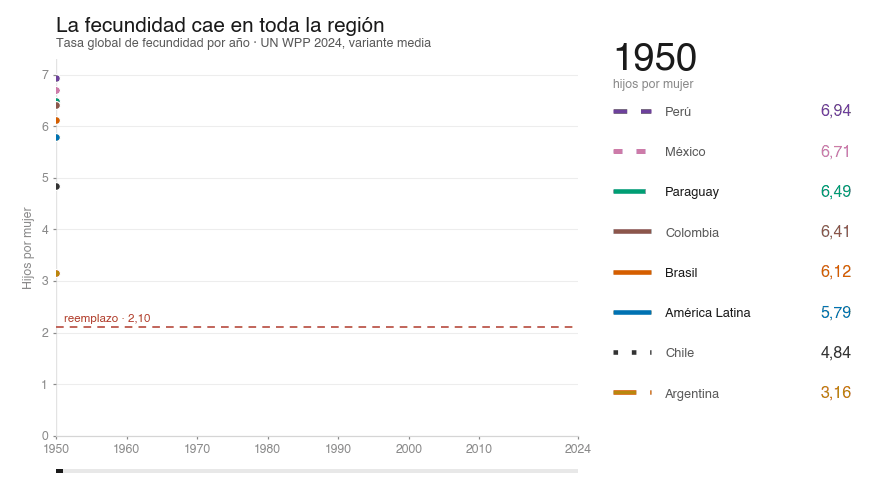

# Paraguay en Datos 🇵🇾

> **Análisis empírico, ciencia de datos y visualizaciones reproducibles sobre la realidad paraguaya.**

Este repositorio centraliza investigaciones cuantitativas, procesamiento de microdatos y visualizaciones sobre demografía, seguridad, salud, economía y movilidad en Paraguay.

---

## 🎯 Principios del Proyecto

1. **Reproducibilidad Total:** Cada gráfico y tabla cuenta con el script de origen (`R` o `Python`) y los datos tabulares procesados para que cualquier persona pueda replicar el resultado exacto.
2. **Trazabilidad y Control de Fuentes:** Los datos provienen estrictamente de fuentes oficiales (INE, Ministerio Público, Policía Nacional, Ministerio de Salud, Banco Mundial, CEPAL, etc.). Se registran manifiestos con URLs originales y sumas de verificación (hashes SHA-256).
3. **Rigor Estadístico:** Distinción clara entre denominadores poblacionales (censos vs. revisiones de proyecciones), advertencia explícita sobre sesgos de registro (causas fiscales vs. víctimas policiales) y neutralidad analítica.

---

## 📂 Estructura del Repositorio

El proyecto se organiza en módulos temáticos autocontenidos:

```text
paraguay-en-datos/
├── demografia/             # Fecundidad, natalidad, pirámides poblacionales y censos
│   ├── datos/
│   ├── figuras/
│   └── scripts/
├── seguridad/              # Homicidios dolosos, feminicidios, distribución geográfica
│   ├── datos/
│   ├── figuras/
│   └── scripts/
├── salud/                  # Mortalidad materna/infantil, cobertura y epidemiología
├── movilidad/              # Tránsito, infraestructura y siniestralidad vial
└── README.md
```

---

## 📊 Investigaciones Destacadas

| Tema | Descripción | Tecnologías | Enlace |
| :--- | :--- | :--- | :--- |
| **Homicidios y Violencia (2006–2024)** | Evolución temporal de víctimas, tasas departamentales y análisis de feminicidio. | R (`ggplot2`), INE, MDI | [Ver módulo `seguridad/`](seguridad/) |
| **Transición Demográfica y Fecundidad** | TGF 1950–2024 para América Latina y el Caribe y siete países; vista generacional (hijos a los 30 años, cohortes 1950–1995). Dos figuras interactivas en D3.js. | D3.js, Python, ONU WPP 2024 | [Ver módulo `demografia/`](demografia/) |

### Figuras interactivas

| Figura | Qué muestra |
| :--- | :--- |
| [TGF 1950–2024](demografia/figuras/tfr-latam-1950-2024.html) | 75 años de caída, ocho series, con conmutador 1950-2024 / últimos 20 años y tooltip por año |
| [Hijos a los 30 por generación](demografia/figuras/tfr-generacional.html) | Cohorte de nacimiento 1950–1995, con eje doble (año de nacimiento y edad en 2025) |
| [Animación 1950–2024](demografia/figuras/tfr-animacion.html) | Reproducción año por año, con pausa, barra de arrastre y panel de valores |

**Animación (GIF, se reproduce solo):**



> Las figuras leen los CSV de `demografia/datos/` con rutas relativas: para verlas en local hace falta
> un servidor estático (`python3 -m http.server 8000`) o GitHub Pages.


---

## 🛠️ Requisitos y Reproducción

Para ejecutar los scripts y regenerar los gráficos:

### Entorno R
```r
# Paquetes habituales
install.packages(c("tidyverse", "ggplot2", "scales", "readxl", "jsonlite"))
```

### Entorno Python
```bash
pip install pandas numpy matplotlib seaborn geopandas
```

---

## ⚖️ Licencia y Cita

* **Código:** Licencia [MIT](LICENSE).
* **Datos y Gráficos:** Puedes utilizarlos, compartirlos y citarlos libremente haciendo referencia a:
  > *Paraguay en Datos — Análisis y visualizaciones empíricas.* [github.com/sanchezmartin093-code/paraguay-en-datos](https://github.com/sanchezmartin093-code/paraguay-en-datos)
